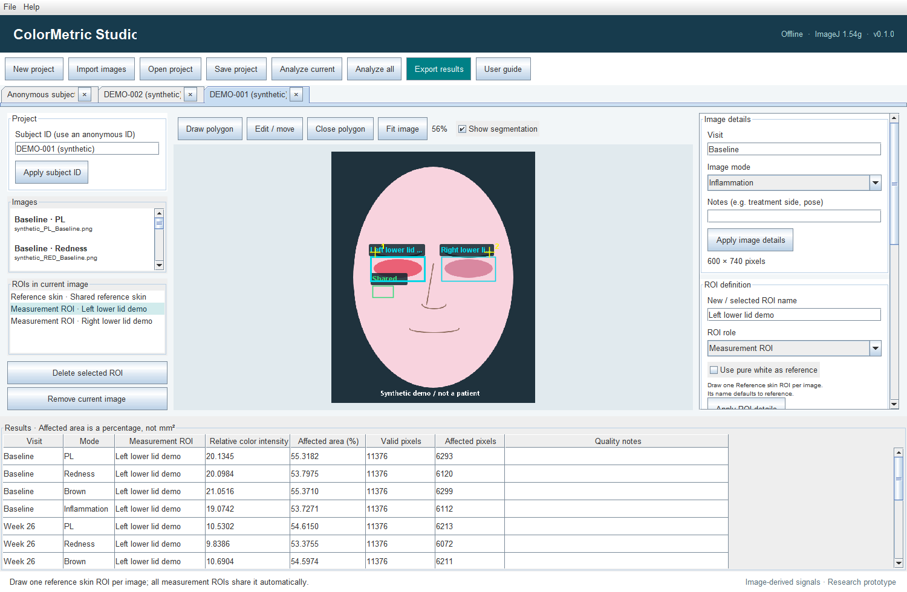

<p align="center"></p>

# ColorMetric Studio

**Quantify color. Track change.**

Offline Windows software for image-derived color intensity and affected-area measurements across **PL, Brown, Redness and Inflammation** spectra-derived image exports. Measurement ROIs can cover **any visible skin region**, not only the periorbital area.

**[Download v0.1.0](https://github.com/Ann0613xyz/ColorMetricStudio/releases/tag/v0.1.0)** · **[User Guide](docs/UserGuide.md)** · **[Measurement methods](docs/Measurement-methods.md)** · **[MIT License](LICENSE.txt)**

## Download and install

| Package | Use |
| --- | --- |
| **[Windows installer (.exe)](https://github.com/Ann0613xyz/ColorMetricStudio/releases/download/v0.1.0/ColorMetricStudio-0.1.0.exe)** | Recommended for most users. Run the installer, then start ColorMetric Studio from the desktop or Start menu. |
| [Windows Installer package (.msi)](https://github.com/Ann0613xyz/ColorMetricStudio/releases/download/v0.1.0/ColorMetricStudio-0.1.0.msi) | Alternative Windows installation package. |
| [Portable edition (.zip)](https://github.com/Ann0613xyz/ColorMetricStudio/releases/download/v0.1.0/ColorMetricStudio-0.1.0-portable.zip) | Extract the entire ZIP and run `ColorMetric Studio/ColorMetric Studio.exe`. Keep the `app` and `runtime` folders together. |
| [Source archive](https://github.com/Ann0613xyz/ColorMetricStudio/releases/download/v0.1.0/ColorMetricStudio-0.1.0-source.zip) | Original application source and build instructions supplied with this release. |

**Requirements:** Windows x64. The English-language application includes ImageJ 1.54g and a Java runtime; no separate ImageJ or Java installation is required. Processing is local and works offline.

Installers are unsigned, so Windows may display an unknown-publisher prompt. Check the file against the release [SHA256SUMS.txt](https://github.com/Ann0613xyz/ColorMetricStudio/releases/download/v0.1.0/SHA256SUMS.txt) before installation. Use **File → Open synthetic demo** to practice without patient photographs.

## Main features

- Batch-import JPG, PNG and TIFF images, including Chinese filenames and folder paths.
- Work with multiple projects in tabs and organize images by subject, visit and imaging mode.
- Draw multiple polygon measurement ROIs, one shared reference skin ROI or an optional pure-white reference, and exclusion polygons.
- Copy selected ROIs between any images, including across open projects; translate polygons without changing their shape or size.
- Edit boundary points and undo unfinished points, whole-ROI moves and vertex edits with Ctrl+Z.
- Use optional two-landmark rigid transfer, with explicit optional uniform scaling.
- Inspect threshold-based segmentation overlays before exporting results.
- Export current-project or all-open-project results to Excel, or create a result ZIP with measurements, overlays, ROI previews and reproducibility metadata.
- Save portable `.pips` projects containing original images, ROI geometry, parameters and history.



*Actual application interface. The demonstration contains no patient photographs.*

## Two values per measurement ROI

| Output | Definition |
| --- | --- |
| **Relative color intensity** | Mean reference-relative signal among affected pixels only. Below-threshold pixels do not contribute. No affected pixels yields N/A. |
| **Affected area (%)** | `100 × affected pixels / valid ROI pixels`, after removing exclusions. No affected pixels yields 0%. |

ImageJ converts RGB to CIELAB under the sRGB/D65 assumption. PL and Brown use reference L* minus pixel L*; Redness and Inflammation use pixel a* minus reference a*. Default exploratory thresholds are 5, 5, 3 and 3 respectively. Keep reference methods and applied parameters consistent across visits, and verify anatomical correspondence after ROI transfer.

These are **image-derived research measurements**, not direct measurements of melanin, hemoglobin, tissue depth or biological inflammation. Area is a percentage, not mm². The software is a research prototype; technical checks do not establish clinical validity. Interpret intensity and area together.

## Documentation

- [Complete User Guide — read on GitHub](docs/UserGuide.md)
- [Original HTML User Guide](docs/UserGuide.html) — download and open locally in a browser
- [Measurement definitions and software design](docs/Measurement-methods.md)
- [Technical validation report](docs/Validation-report.md)
- [Automated check results](docs/Automated-checks.txt)
- [Application license](LICENSE.txt)
- [Third-party notices](THIRD-PARTY.txt)

## Build from this repository

For developers only. End users should download an installer or the portable edition above.

Requirements: Windows x64, JDK 21 available on PATH, and the supplied ImageJ JAR. The build helper retrieves the official WiX 3.14.1 tools and verifies their checksum.

```powershell
cd software/colormetric-studio
./tools/Get-BuildTools.ps1
./build.ps1 -Stage all
```

Build products are written to `outputs/ColorMetricStudio-0.1.0` at the repository root. The original build script refuses to overwrite an existing application image; use a fresh build directory for a rebuild.

## License and components

Application code is released under the **MIT License**. ImageJ, the reduced Microsoft OpenJDK runtime and WiX-related components retain their own licenses and notices. Keep these notices with redistributed packages. See [THIRD-PARTY.txt](THIRD-PARTY.txt) and the installed `runtime/legal/` folder.
